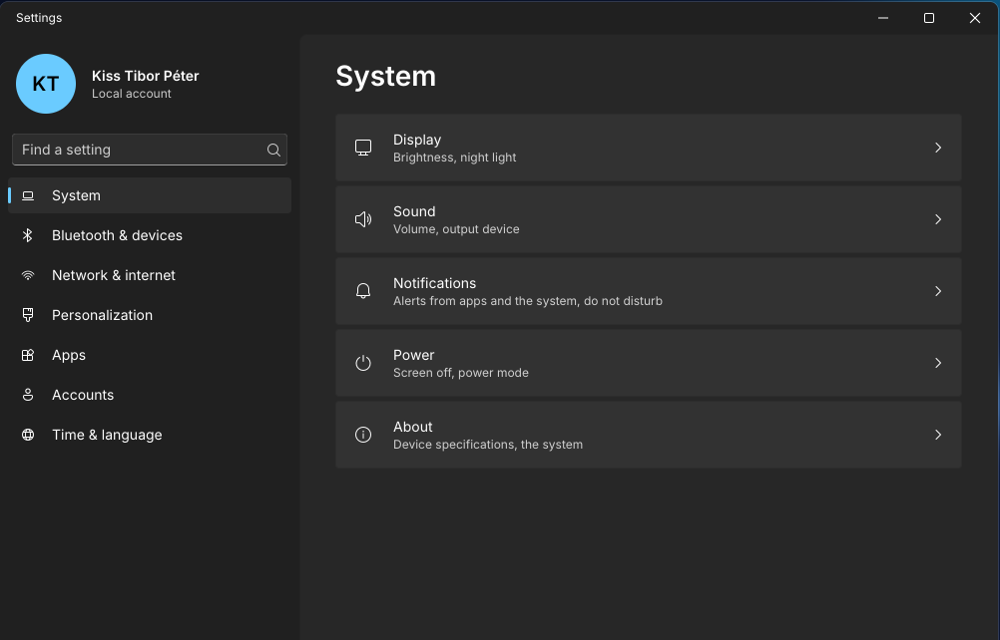

# Fluxion Settings

Settings for [Fluxion Desktop](https://github.com/kisstp2006/fluxion-de): the
look of the desktop, the screen, the sound, the network, Bluetooth, the
apps, the account and the clock - laid out the way Windows 11's Settings
is, a list of areas on the left and the page on the right, and drawn with
[Fluxion Widgets](https://github.com/kisstp2006/fluxion-widgets) on the CPU.



## What it does

| Area | Pages |
| --- | --- |
| System | Display (brightness, night light and its strength), Sound (volume, mute, output device), Notifications (do not disturb), Power (screen off after, power mode), About (the processor, the memory, the system) |
| Bluetooth & devices | Bluetooth on or off, the devices paired |
| Network & internet | The connection there is, Wi-Fi on or off |
| Personalization | Background (a picture to choose), Colors (light or dark, the accent colour) |
| Apps | The apps installed, searched and opened |
| Accounts | Your name, your account, whether it is an administrator's |
| Time & language | The time zone, the language, the keyboard layout |

"Find a setting", at the top of the list, finds a page by what is on it.

What belongs to the system is read from and written to the services that
own it, and nothing is kept twice: the brightness and the power mode
through logind and power-profiles-daemon, Bluetooth through BlueZ, the
network through NetworkManager, the sound through `pactl`. What belongs to
the desktop is kept in `$XDG_CONFIG_HOME/fluxion/settings.ini`, which the
shell watches and takes as it is written:

```ini
[appearance]
mode=dark
accent=#1F6FCC

[desktop]
wallpaper=/usr/share/backgrounds/f45/default/f45-01-day.jxl

[display]
night_light=true
night_light_kelvin=4500

[notifications]
do_not_disturb=false

[power]
screen_off_minutes=5
```

The wallpapers to choose from are your own, in `~/Pictures/Wallpapers`, and
the system's, under `/usr/share/backgrounds`: PNG and JPEG, and - through
libwebp, libjxl and librsvg, where they are installed - WebP, JPEG XL and
SVG. Their thumbnails are kept in `$XDG_CACHE_HOME/fluxion/wallpapers`.

## Opening it at a page

```bash
fluxion-settings display
```

`display`, `sound`, `notifications`, `power`, `about`, `bluetooth`, `wifi`,
`network`, `background`, `colors`, `apps`, `accounts`, `datetime` and
`region` open it at that page; so do links such as `settings:display`.
With none, it opens at System.

## Building it

It needs Zig 0.16, and the Fluxion packages it is written beside, checked
out next to each other:

```
~/fluxion/fluxion-widgets
~/fluxion/fluxion-image
~/fluxion/fluxion-dbus
~/Documents/fluxion-settings
```

On Fedora, besides:

```bash
sudo dnf install wayland-devel libxkbcommon-devel
```

Then:

```bash
zig build run -- display
```

runs it on the desktop you are on, and

```bash
tools/install.sh
```

builds a release and installs it into `/usr/local` - asking for your
password for that step only - for the shell to open.

## License

BSD 2-Clause. See [LICENSE](LICENSE).
